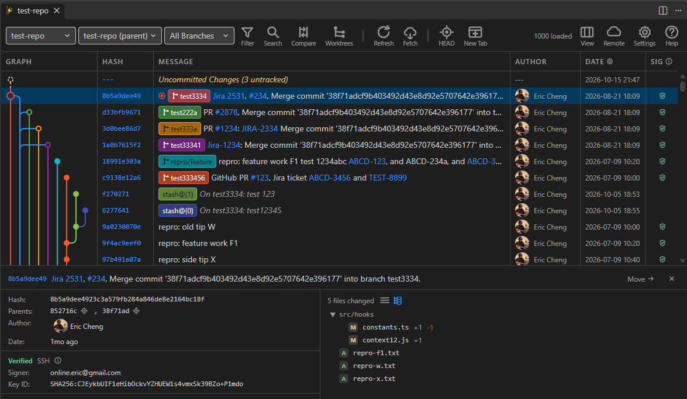
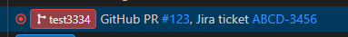
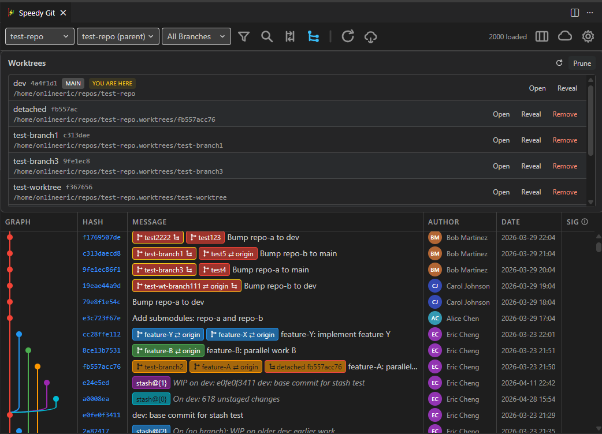
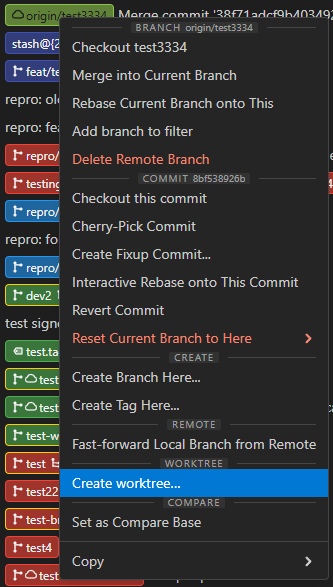
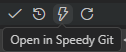
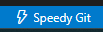

# Speedy Git — Fast Git Graph & History UI for VS Code and Cursor

A performance-first Git graph, history viewer, history-editing tool, and worktrees manager built for developers who want speed, clarity, and real Git workflow power — without the bloat.

**Speedy Git** renders large repositories instantly with virtual scrolling and batch prefetch, so you can browse thousands of commits, review diffs, and run Git operations — all from one clean panel inside VS Code or Cursor.

> If you've been looking for a **fast git graph**, a **lightweight git history viewer**, or a **practical rebase and cherry-pick UI** that doesn't slow you down — Speedy Git is built for exactly that.

## Why Speedy Git?

| What you get | How it works |
|---|---|
| **Instant graph rendering** | Virtual scrolling + batch prefetch keeps large repos responsive — no loading spinners, no lag |
| **Real Git operations** | Merge, rebase, cherry-pick, revert, reset, amend, fixup, drop commit, push, pull, fetch — all from context menus with live command preview |
| **Compare anything to anything** | Two-click A vs B diff for any commit, branch, tag, or your working tree — with PR-style three-dot mode |
| **Search and filter** | Multi-term search across messages, hashes, authors, emails, branches, and tags, then narrow history with branch, author, and date filters — optionally keeping every branch tip visible |
| **Multiple graph tabs** | Open as many graphs as you like, each with its own repository, filters, search, and scroll position |
| **Worktrees** | Run AI coding sessions on different branches at the same time without constantly switching your main checkout |
| **Clean, scannable UI** | Color-coded branch lanes, icon-based local/remote badges, avatars, clickable issue links, and full VS Code theme support |
| **History editing workflow** | Interactive rebase with drag-and-drop reordering (pick, squash, fixup, reword, drop) and autosquash |
| **Works in VS Code and Cursor** | Published on both VS Code Marketplace and Open VSX |

## What's New in v5

### Autolinks for issues, PRs, and tickets
`#123`, `GH-123`, `!123` and `owner/repo#123` link to GitHub or GitLab automatically, and you can add your own rules — such as Jira keys like `ABCD-123` — in the **Autolinks** settings tab (GitLens's `gitlens.autolinks` format, so an existing list can be copied in). Links appear in the Message column, the details panel, and the commit tooltip.

### Worktrees for multi-session AI coding
Create, open, reveal, and remove Git worktrees so different AI agents or editor sessions can work on different branches at the same time without switching your main checkout. Choose a nested (`feat/branch1`) or flattened (`feat-branch1`) folder, and optionally copy `.env` files into the new worktree.

### Faster navigation
- **Double-click a branch badge** to check it out — remote badges create a tracking branch or offer to pull.
- **Go to HEAD** jumps straight to the checked-out commit, loading more history if needed.
- **Go to parent / child commit** from the details panel, including each parent of a merge.
- **Smarter search** — space-separated terms are AND-ed, `"quoted text"` matches literally, and the matching text is boxed inside each row.

## Core Feature Summary
>Right-click menu — there are even more features in other menus and panels!  
>
>

- Fast commit graph and history browsing with virtual scrolling, color-coded branch lanes, table-style rows, resizable columns, avatars, and clear HEAD/ref labels.
- Powerful search across messages, hashes, authors, emails, branches, and tags, plus filtering by branch, author, and date (with an option to keep badged commits such as branch tips visible), with match navigation for large histories.
- Compare any two refs (commits, branches, tags, `HEAD~3`, or your working tree) with PR-style three-dot diffs.
- Commit details with resizable bottom/right layout, file tree/list views, per-file stats, parent/child navigation, and inline diffs — including stashed untracked files and submodule pointer changes.
- Branch, tag, stash, remote, submodule, worktree, and multi-repo workflows from one panel, including fetch, pull, push, checkout, merge, and remote management.
- History editing tools for interactive rebase, amend, fixup, cherry-pick, revert, reset, and drop commit, with conflict-aware continue/abort flows.
- On-demand GPG and SSH commit signature verification in a dedicated Signature column.
- Live Git command previews in major dialogs, plus personalization for graph colors, date format, ref visibility, avatars, autolinks, toolbar labels, and persisted panel layout.

## How Speedy Git Compares

| | Speedy Git | Heavy all-in-one Git extensions | Basic Git graph viewers |
|---|---|---|---|
| Large repo performance | Virtual scrolling, batch prefetch | Can lag on large histories | Often loads everything at once |
| AI-ready worktrees | Parallel branch worktrees for multi-session AI coding | Varies or requires separate tools | Rare |
| Search, filter, and compare | Built-in search, advanced filters, and A vs B compare | Usually available, often spread across views | Limited |
| History editing | Rebase, cherry-pick, revert, drop, reset — all in-panel | Varies | View-only or minimal |
| Commit signature verification | On-demand GPG and SSH verification | Varies | Rare |
| Live command preview | Every dialog shows the exact git command | Rare | No |
| UI clarity | Merged branch labels, color-coded lanes, avatars | Feature-dense, complex UI | Basic |
| Repo support | Multi-repo switching, multiple graph tabs, submodule navigation, worktree visibility | Varies | Rare |
| Startup overhead | Lightweight, focused graph tabs | Extension suite, multiple views | Lightweight |

## Quick Start

1. Install **Speedy Git** from [VS Code Marketplace](https://marketplace.visualstudio.com/items?itemName=onlineeric.speedy-git-ext) or [Open VSX](https://open-vsx.org/extension/onlineeric/speedy-git-ext).
2. Open any Git repository in VS Code or Cursor.
3. Launch Speedy Git from the Source Control panel icon, the status bar button, or press `Ctrl+Shift+G` (`Cmd+Shift+G` on Mac). This returns to the graph you were last in; the Source Control icon opens a graph for that specific repository.
4. Use **New Tab** in the toolbar for another graph, and the **Help** button for links, feedback, and the badge legend.

Open Speedy Git from the Source Control panel:

Open Speedy Git from the status bar:

## Telemetry

Speedy Git collects **anonymous, aggregate-only usage statistics** (feature
usage, standardized error codes, and performance timings) to improve
compatibility, reliability, and product direction. It never collects repository
content, repository names or paths, or anything you type.

Telemetry is sent only when both VS Code's global telemetry setting and
`speedyGit.telemetry.enabled` are enabled. Turning either setting off stops all
collection immediately.

What is collected

- Feature and UI usage from fixed action identifiers, operation outcomes, and
  standardized error codes.
- Performance timings, with commit counts reported only as coarse ranges.
- Editor, operating system, and extension versions; Speedy Git setting choices;
  and VS Code's anonymized machine and session identifiers.

Speedy Git never collects repository or workspace names and paths; remote URLs;
branch, tag, stash, or worktree names; commit hashes, messages, or diffs; author
names, emails, or avatars; Git configuration values; file names or paths; raw
Git output or exception messages; search or filter values; or anything entered
into an input.

The exact event schema is available in [`telemetry.json`](telemetry.json). Every
sent event is also recorded in the **Speedy Git Telemetry** output channel.

## Issues, Feature Requests & Feedback

- Issues and feature requests: [GitHub Issues](https://github.com/onlineeric/speedy-git-ext/issues)
- Source code: [github.com/onlineeric/speedy-git-ext](https://github.com/onlineeric/speedy-git-ext)
- License: [MIT](LICENSE.md)
